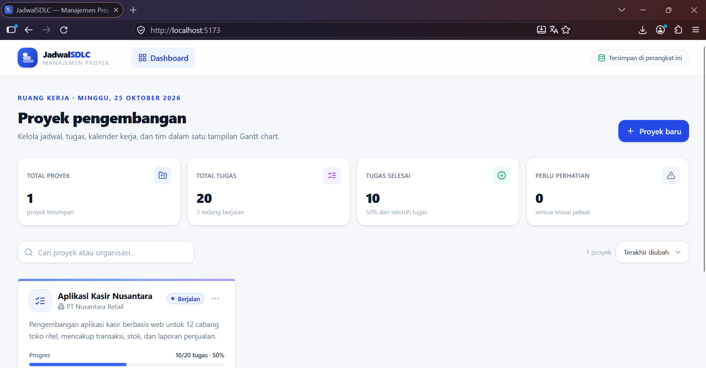
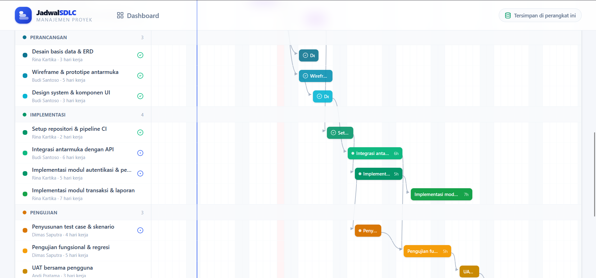
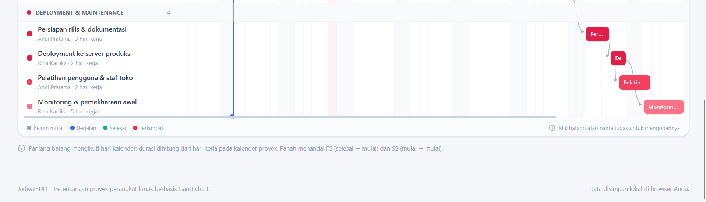

JadwalSDLC

JadwalSDLC adalah aplikasi sistem informasi untuk membantu perencanaan dan pemantauan jadwal proyek pengembangan perangkat lunak menggunakan metode visualisasi Gantt Chart.

Fitur Utama

- Dashboard: Menampilkan ringkasan informasi dan progres proyek.
- Gantt Chart: Menampilkan jadwal, durasi, dan urutan pengerjaan tugas secara visual.
- Manajemen Tugas: Membantu mengatur aktivitas dalam tahapan Software Development Life Cycle (SDLC).
- Pemantauan Proyek: Membantu pengguna melihat perkembangan pelaksanaan proyek.
- Penyimpanan Lokal: Menyimpan data aplikasi pada browser menggunakan localStorage.

Teknologi yang Digunakan

- React
- TypeScript
- Vite
- CSS
- localStorage

Tampilan Aplikasi

1. Dashboard

2. Gantt Chart
Berikut adalah tampilan Gantt Chart JadwalSDLC yang dibagi menjadi tiga screenshot agar seluruh jadwal proyek dapat terlihat dengan jelas.

Tujuan Pengembangan

Aplikasi ini dikembangkan sebagai implementasi sistem informasi berbasis teknologi untuk membantu proses perencanaan jadwal proyek perangkat lunak agar lebih terstruktur dan mudah dipantau.

Repository

Source code aplikasi tersedia di [GitHub - JadwalSDLC](https://github.com/NabilaYusuf61/jadwalsdlc).
